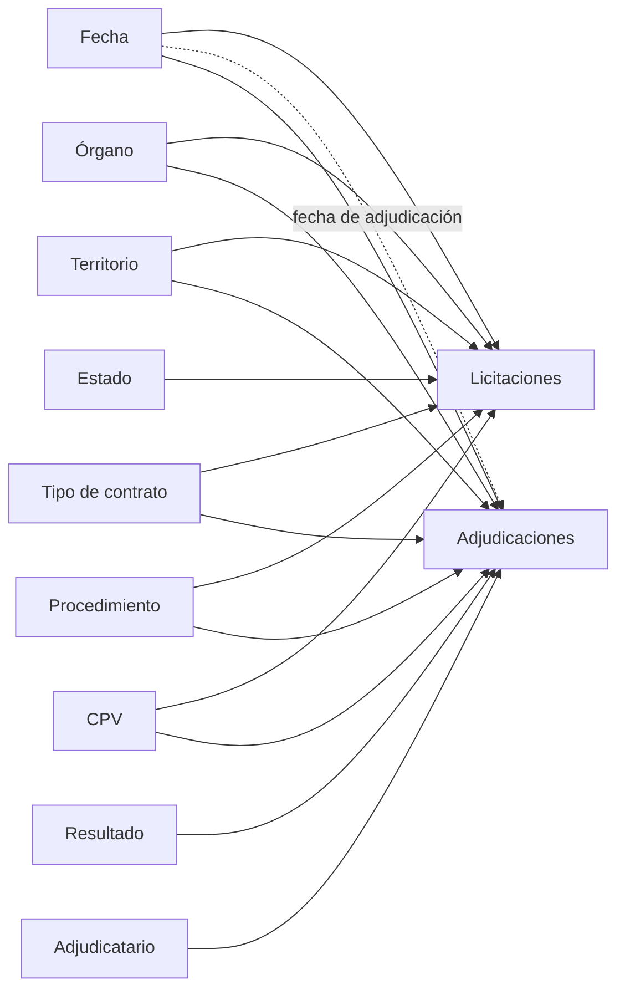

# Contratación pública en Power BI

Un informe de **Power BI** sobre la contratación pública española de enero a septiembre de 2026: cuánto se licita,
quién compra, quién gana, cuánta competencia hay y cuánta baja de precio se consigue, por comunidad, tipo de contrato,
procedimiento y mes.

**Power BI (PBIP, TMDL y PBIR) · DAX · Power Query · DuckDB · Python · .NET (TOM)**

El proyecto está en **formato PBIP**: el modelo semántico en TMDL (texto, una tabla por fichero) y el informe en PBIR.
Se versiona en Git y el DAX se lee aquí mismo, sin abrir Power BI:
[medidas](Contratacion.SemanticModel/definition/tables/Medidas.tmdl) ·
[grupo de cálculo](Contratacion.SemanticModel/definition/tables/Periodo.tmdl) ·
[relaciones](Contratacion.SemanticModel/definition/relationships.tmdl) ·
[seguridad por filas](Contratacion.SemanticModel/definition/roles/Comunidad.tmdl).

| | Enero a septiembre de 2026 |
|---|---:|
| Licitaciones publicadas | 125.658 |
| Importe licitado (sin IVA) | 73.644 millones de € |
| Importe mediano por licitación | 50.413 € |
| Resultados adjudicados | 110.448 |
| Baja media sobre el importe licitado | 11,9 % |
| Adjudicaciones con una sola oferta | 48,7 % |
| Importe adjudicado a pymes | 28,0 % |

Todas las cifras, y las de cada mes, tipo de contrato y comunidad, en [cifras de control](docs/cifras-de-control.md).
La media (604.372 €) está muy por encima de la mediana: unos pocos contratos enormes (un acuerdo marco de suministro
de energía de 4.680 millones, trenes de alta velocidad...) pesan mucho en el total.

## Los datos

Licitaciones de la [Plataforma de Contratación del Sector Público](https://contrataciondelsectorpublico.gob.es):
los paquetes mensuales de 2026, cargados con el [radar de licitaciones](https://github.com/marnau74/radar-licitaciones),
que lee el formato CODICE, se queda con la última versión de cada licitación y guarda lotes y resultados.

`preparar/exportar.py` lee la base del radar con DuckDB y escribe un modelo en estrella en Parquet (en la *release*
del repositorio, no en Git). Solo entran las licitaciones **publicadas** en el periodo y no anuladas. Antes de
escribir nada comprueba el modelo y se para si algo falla: claves únicas, ninguna clave sin su dimensión, importes no
negativos y el mismo número de licitaciones por mes que en la base.

**Datos personales.** Entre los adjudicatarios hay personas físicas (autónomos) que la Plataforma publica con su nombre
y su DNI. En los Parquet salen como «Persona física» y con un código en lugar del DNI, calculado con una sal aleatoria
que no se guarda: se pueden contar y la relación del modelo funciona, pero no se puede volver al DNI. Muchos NIF llegan
mal escritos o recortados (`0002`, `1806441B`); cuando el NIF no es el de una entidad española y el nombre no tiene nada
de organización (forma jurídica, UTE, fundación, universidad…), se trata igual y sale como «Posible persona física»:
ante la duda, se protege. Las empresas y las administraciones no cambian. Las cifras de control son las mismas.

## Modelo



- **Dos tablas de hechos**: licitaciones (una fila por licitación) y adjudicaciones (una por resultado de la
  licitación o de cada lote, con el importe licitado que le corresponde). Dimensiones compartidas, relaciones de uno a
  varios en una sola dirección y la fecha de adjudicación como relación inactiva
  (`USERELATIONSHIP`). Ver [ADR 2](docs/adr/0002-estrella-con-dos-hechos.md).
- **24 medidas explícitas**, todas con descripción, formato y carpeta: volumen, adjudicación (la **baja** como cociente
  de sumas sobre importes comparables, ofertas por adjudicación, % con una sola oferta, % a pymes), tiempo y ranking
  (`RANKX`, `TOPN`, un segmentador de *top N* y la concentración de los diez primeros adjudicatarios).
- **Grupo de cálculo «Periodo»**: actual, mes anterior, variación, variación % y lo que va de año para cualquier medida.
- **Seguridad por filas**: el rol «Comunidad» filtra el territorio por el correo del usuario.
- Jerarquías (calendario, comunidad y provincia, administración y órgano), columnas ordenadas por su número, tabla de
  fechas marcada, claves ocultas y nombres en español.

## Comprobaciones

- **Exportación** (pytest, 28 pruebas): sobre una base del radar en miniatura con los casos difíciles a propósito
  (lotes, códigos que no están en el catálogo, territorio solo de comunidad o en el extranjero, importes absurdos) y
  la estructura del proyecto PBIP.
- **Modelo** (`validar/`, .NET con la biblioteca oficial **TOM**): lee el TMDL como lo hace Power BI y comprueba que
  todas las medidas tienen descripción, formato y carpeta; que las relaciones son de varios a uno en una dirección con
  la clave oculta; que hay tabla de fechas; y que **cada referencia del DAX** a una tabla, columna o medida existe.
- **Informe**: los ficheros PBIR contra los esquemas JSON publicados por Microsoft.
- **Cifras de control** ([docs/cifras-de-control.md](docs/cifras-de-control.md)): lo que tiene que dar cada medida,
  calculado con DuckDB sobre los mismos Parquet. Con el proyecto abierto en Power BI Desktop, `validar` se conecta a
  su motor, refresca el modelo y **evalúa cada medida con DAX** contra esas cifras.

Hecho con Power BI Desktop 2.158 (octubre de 2026): Desktop abre el proyecto tal cual, el refresco carga en cada tabla
exactamente las filas exportadas y **las 40 cifras de control coinciden** (15 medidas y 25 valores de los desgloses).
Además se comprobó con consultas DAX que el grupo de cálculo da el mes anterior y el acumulado correctos, que el
ranking ordena bien y que el rol «Comunidad» no deja ver nada a una cuenta que no está en la tabla de acceso.

## Ponerlo en marcha

1. Descargar los Parquet de la *release* (o generarlos, ver abajo) en una carpeta.
2. Abrir `Contratacion.pbip` con Power BI Desktop (activar «Guardar como proyecto de Power BI» en las opciones de
   vista previa si la versión lo pide).
3. Transformar datos > Editar parámetros > `CarpetaDeDatos`: la carpeta de los Parquet, terminada en `\`.
4. Actualizar.

Para generar los datos hace falta el radar con los paquetes de 2026 cargados:

```bash
uv run python -m preparar.exportar --postgres "host=localhost port=5434 dbname=radar user=radar password=radar"
```

```bash
uv run python -m preparar.cifras
```

Comprobar el modelo (sin Power BI) y, con el proyecto abierto en Desktop, contra las cifras de control (el puerto
está en `msmdsrv.port.txt`, dentro de la carpeta de trabajo de Desktop):

```bash
dotnet run --project validar -- Contratacion.SemanticModel/definition
```

```bash
dotnet run --project validar -- refrescar <puerto>
```

```bash
dotnet run --project validar -- comparar <puerto> datos/cifras.json
```

## Lo que falta: las páginas visuales

Las cinco páginas están creadas con el tema aplicado, pero los visuales se montan en Power BI Desktop siguiendo la
[especificación página a página](docs/especificacion-del-informe.md): resumen, quién compra, quién gana, competencia
y una página de detalle con obtención de detalles hacia la ficha de cada licitación.

## Licencia

[MIT](LICENSE). Datos: Plataforma de Contratación del Sector Público (reutilización de información del sector
público, Ley 37/2007).
